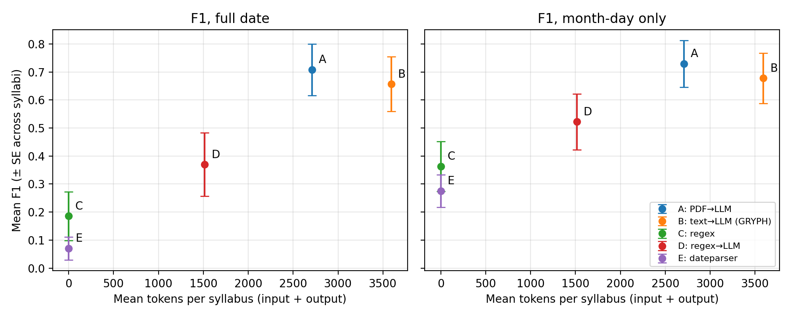

# Syllabus Deadline Extraction Benchmark

Cost and accuracy of five ways to pull deadlines out of course syllabus PDFs: rules, a date library, native-PDF LLM input, extracted-text LLM input, and a rule-first hybrid that only calls the LLM when the rules look weak.

**16 public syllabi · 5 strategies · 3 repeats · `gemini-3.1-flash-lite` · run 2026-10-25 · 0 failed calls**

**Paper (preprint):** Patel, S. (2026). *Cheap First, Ask the LLM Later? Cost and Accuracy of Rule-Based, Native-PDF, and Text-Based LLM Extraction of Syllabus Deadlines.* Preprints. https://www.preprints.org/manuscript/202610.2704/v1 (DOI: 10.20944/preprints202610.2704.v1)

## Strategies

| ID | Strategy | LLM call? |
|---|---|---|
| A | Send the binary PDF to Gemini | always |
| B | Extract text with pypdf, send the text to Gemini (the pipeline GRYPH OS ships) | always |
| C | pypdf text + GRYPH OS's regex rules | never |
| D | Regex first; call Gemini (B) only if regex finds fewer than 3 events | sometimes |
| E | pypdf text + `dateparser` (general-purpose date library), same line loop as C | never |

## Results

| Strategy | F1 (full date) | F1 (month-day) | Tokens / syllabus | LLM called |
|---|---|---|---|---|
| A: PDF → LLM | **0.708 ± 0.367** | **0.729** | 2,710 | 100% |
| B: text → LLM | 0.657 ± 0.389 | 0.678 | 3,593 | 100% |
| D: regex → LLM | 0.370 ± 0.453 | 0.522 | 1,515 | 31% |
| C: regex | 0.186 ± 0.349 | 0.363 | 0 | 0% |
| E: dateparser | 0.070 ± 0.163 | 0.275 | 0 | 0% |

± is the standard deviation across syllabi. Full tables: [`runs/20261025-060628/summary.md`](runs/20261025-060628/summary.md) · error analysis: [`figures/error_analysis.md`](figures/error_analysis.md) · router sweep: [`figures/router_sweep.md`](figures/router_sweep.md).



**Key observations**
- Native-PDF input was at least as accurate as extracted text (A − B = +0.05 F1, p = 0.13, not significant) and, with this model, cheaper (text used 32.6% more tokens in total).
- The rule-first hybrid saved 57.8% of tokens versus text → LLM but lost almost half the F1 (B − D = +0.29, p = 0.002). Regex event count is a poor confidence signal (F1 0.18 when the regex was trusted vs 0.79 when the LLM was called).
- Wrong year is the dominant rule-based failure: 58% of regex date matches and 85% of dateparser matches had the wrong year, versus 2% for the LLM strategies.
- Calendar-grid layouts lose their dates in text extraction (recall on two grid syllabi: A 0.78, B 0.11–0.52, rules 0).
- On a syllabus with no fixed dates, the LLM strategies turned each "TBD between Oct 16–18"-style window into one fixed date (first day for text input, usually last day for PDF input) — false precision.

## Reproduce

```bash
python -m venv .venv && .venv/Scripts/activate      # or: source .venv/bin/activate
pip install -r requirements.txt
python download.py                                  # fetches the 16 PDFs, checks SHA-256
python bench.py --strategies CE                     # rule-based strategies, no API key needed
echo "GEMINI_API_KEY=..." > .env                    # for A, B, D
echo "GEMINI_MODEL=gemini-3.1-flash-lite" >> .env
python bench.py --strategies ABCDE --repeats 3 --workers 4
python rescore.py <run_id>                          # tables
python analyze.py <run_id>                          # figures + error analysis
python sweep.py <run_id>                            # hybrid-router threshold sweep (offline)
```

`python rescore.py 20261025-060628` re-scores the saved predictions in `runs/` without any API calls.

**Reproducibility notes.** Strategies C and E fill a missing year with the *current* year (GRYPH OS behaviour, kept on purpose), so their full-date scores change if you rerun them in a different calendar year; month-day scores do not. Versions are pinned in `requirements.txt` — the pypdf version alone changed regex results several-fold on the same PDFs. LLM results depend on the model and date; models used during development (`gemini-2.0-flash`, `gemini-2.5-flash`) were retired or unavailable to new projects by the run date. Syllabi may change online; `download.py` reports any checksum mismatch.

## Data
- `syllabi.csv` — source URL, SHA-256, size, access date. **PDFs are not redistributed**; copyright belongs to the issuing institutions.
- `labels/` — hand-verified gold deadlines (see [`ANNOTATION.md`](ANNOTATION.md)).
- `runs/20261025-060628/` — every prediction (`preds/`), run metadata, per-call results.

## Credits
- Strategies B and C use the extraction code of [GRYPH OS](https://github.com/SoumyA4348/GryphOS) (MIT, © 2026 Soumya Patel, Manas Verma), bundled unchanged in `vendor/gryph_os/`.
- Author: Soumya Patel, Independent Researcher.

## License
MIT (code, labels, results). Syllabi remain the property of their institutions.

## Citation

```bibtex
@misc{patel2026cheapfirst,
  author    = {Patel, Soumya},
  title     = {Cheap First, Ask the LLM Later? Cost and Accuracy of Rule-Based, Native-PDF, and Text-Based LLM Extraction of Syllabus Deadlines},
  year      = {2026},
  publisher = {Preprints},
  doi       = {10.20944/preprints202610.2704.v1},
  url       = {https://www.preprints.org/manuscript/202610.2704/v1}
}
```
